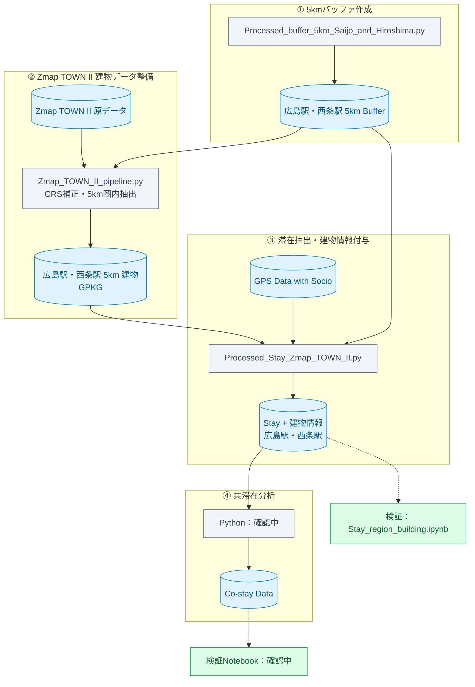

# 全体フロー

## GPSデータの処理手順

## 各工程の詳細

| 工程 | 入力 | Python | 出力 | 検証Notebook |
|---|---|---|---|---|
| ① 5kmバッファ作成 | 広島駅・西条駅の位置情報 | `Processed_buffer_5km_Saijo_and_Hiroshima.py` | 広島駅・西条駅の5kmバッファ | — |
| ② 建物データ整備 | Zmap TOWN II原データ + 5kmバッファ | `Zmap_TOWN_II_pipeline.py` | 広島駅・西条駅の建物GPKG | — |
| ③ 滞在抽出・建物付与 | GPS Data with Socio + 建物GPKG + 5kmバッファ | `Processed_Stay_Zmap_TOWN_II.py` | Stay + 建物情報（Parquet） | `Stay_region_building.ipynb` |
| ④ 共滞在分析 | Stay + 建物情報 | 確認中 | Co-stay Data | 確認中 |

## 入出力ファイル

### ① 5kmバッファ作成

**Python**
`02_Scripts/Processed/Processed_buffer_5km_Saijo_and_Hiroshima.py`

**出力**
- `01_Data/Building/Buffer_5km/buffer_5km_HiroshimaStation.gpkg`
- `01_Data/Building/Buffer_5km/buffer_5km_SaijoStation.gpkg`

### ② Zmap TOWN II 建物データ整備

Zmap TOWN II原データのCRSを補正し、各駅の5kmバッファに対応する建物データを作成する。

**Python**
`02_Scripts/Processed/Zmap_TOWN_II_pipeline.py`

**入力**
- `01_Data/external/Zmap TOWN II (2020年度 Shape版) 広島県 データセット/`
- `01_Data/Building/Buffer_5km/buffer_5km_HiroshimaStation.gpkg`
- `01_Data/Building/Buffer_5km/buffer_5km_SaijoStation.gpkg`

**出力**
- `01_Data/Building/GPKG_Zmap_Town_II/Hiroshima_5km_buildings.gpkg`
- `01_Data/Building/GPKG_Zmap_Town_II/Saijo_5km_buildings.gpkg`

### ③ 滞在抽出・建物情報付与

GPSデータから各駅5km圏内の滞在を抽出し、建物ポリゴンと対応付ける。

**Python**
`02_Scripts/Processed/Processed_Stay_Zmap_TOWN_II.py`

**入力**
- `01_Data/raw/GPS_data_with_socio/`
- `01_Data/Building/GPKG_Zmap_Town_II/Hiroshima_5km_buildings.gpkg`
- `01_Data/Building/GPKG_Zmap_Town_II/Saijo_5km_buildings.gpkg`
- 広島駅・西条駅の5kmバッファ

**出力**
- `01_Data/processed/Stay_region_building/Stay_Hiroshima_5km_building_Z.parquet`
- `01_Data/processed/Stay_region_building/Stay_Saijo_5km_building_Z.parquet`

**検証Notebook**
`02_Scripts/Check/Stay_region_building.ipynb`

### ④ 共滞在分析

建物情報が付与されたStayデータから、同一建物内における異なるユーザー間の共滞在を抽出する。

**Python：** 確認中

**入力：** ③で作成したStayデータ

**出力：** Co-stay Data

**検証Notebook：** 確認中
