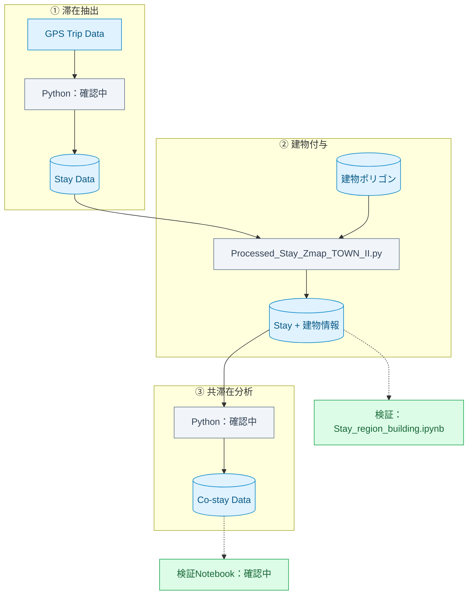

# 全体フロー

## GPSデータの処理手順

## 各工程の詳細

| 工程 | 入力 | Python | 出力 | 検証Notebook |
|---|---|---|---|---|
| 滞在抽出 | GPS Trip | 確認中 | Stay | 確認中 |
| 建物付与 | Stay + 建物 | Processed_Stay_Zmap_TOWN_II.py | Stay + 建物情報 | Stay_region_building.ipynb |
| 共滞在分析 | Stay + 建物情報 | 確認中 | Co-stay | 確認中 |
