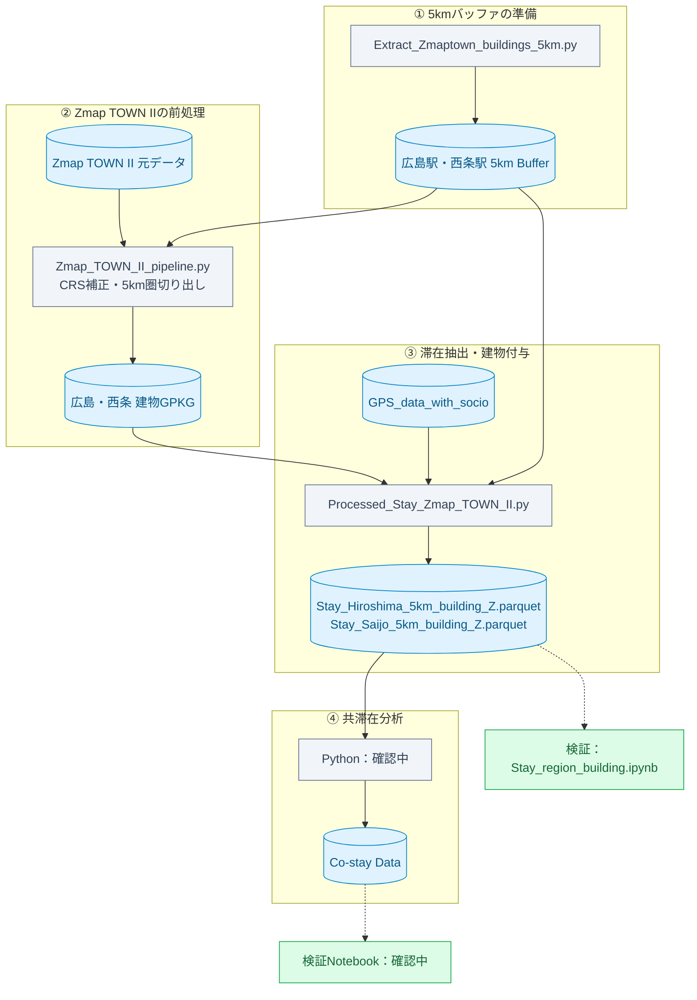

# 全体フロー

## GPSデータの処理手順

## 各工程の詳細

| 工程 | 入力 | Python | 出力 | 検証Notebook |
|---|---|---|---|---|
| ① 5kmバッファ準備 | 広島駅・西条駅の位置情報 | `Extract_Zmaptown_buildings_5km.py` | 5kmバッファ | — |
| ② 建物ポリゴン前処理 | Zmap TOWN II + 5kmバッファ | `Zmap_TOWN_II_pipeline.py` | 地域別建物GPKG | — |
| ③ 滞在抽出・建物付与 | GPS_data_with_socio + 建物GPKG + 5kmバッファ | `Processed_Stay_Zmap_TOWN_II.py` | 地域別Stay Parquet | `Stay_region_building.ipynb` |
| ④ 共滞在分析 | Stay + 建物情報 | 確認中 | Co-stay | 確認中 |

## 入出力ファイル

### ① 5kmバッファ

実行コード：

`02_Scripts/Processed/Extract_Zmaptown_buildings_5km.py`

使用するバッファ：

- `01_Data/Building/Buffer_5km/buffer_5km_HiroshimaStation.gpkg`
- `01_Data/Building/Buffer_5km/buffer_5km_SaijoStation.gpkg`

### ② Zmap TOWN IIの前処理

実行コード：

`02_Scripts/Processed/Zmap_TOWN_II_pipeline.py`

入力：

- `01_Data/external/Zmap TOWN II (2020年度 Shape版) 広島県 データセット`
- ①の5kmバッファ

処理：

1. Zmap TOWN IIの座標参照系（CRS）を補正する。
2. 広島駅・西条駅の5kmバッファに合わせて建物ポリゴンを抽出する。
3. 地域別のGeoPackageファイルを作成する。

出力：

- `01_Data/Building/GPKG_Zmap_Town_II/Hiroshima_5km_buildings.gpkg`
- `01_Data/Building/GPKG_Zmap_Town_II/Saijo_5km_buildings.gpkg`

### ③ 滞在抽出・建物付与

実行コード：

`02_Scripts/Processed/Processed_Stay_Zmap_TOWN_II.py`

入力：

- `01_Data/raw/GPS_data_with_socio/`
- ②で作成した地域別建物GPKG
- ①の5kmバッファ

処理：

1. GPSデータから対象地域内の滞在を抽出する。
2. 滞在位置と建物ポリゴンを空間的に対応付ける。
3. 建物情報を付与した滞在データを保存する。

出力：

- `01_Data/processed/Stay_region_building/Stay_Hiroshima_5km_building_Z.parquet`
- `01_Data/processed/Stay_region_building/Stay_Saijo_5km_building_Z.parquet`

検証Notebook：

`02_Scripts/Check/Stay_region_building.ipynb`

### ④ 共滞在分析

入力：

- ③で作成した建物情報付きStayデータ

実行コード：確認中

出力：Co-stay Data

検証Notebook：確認中
